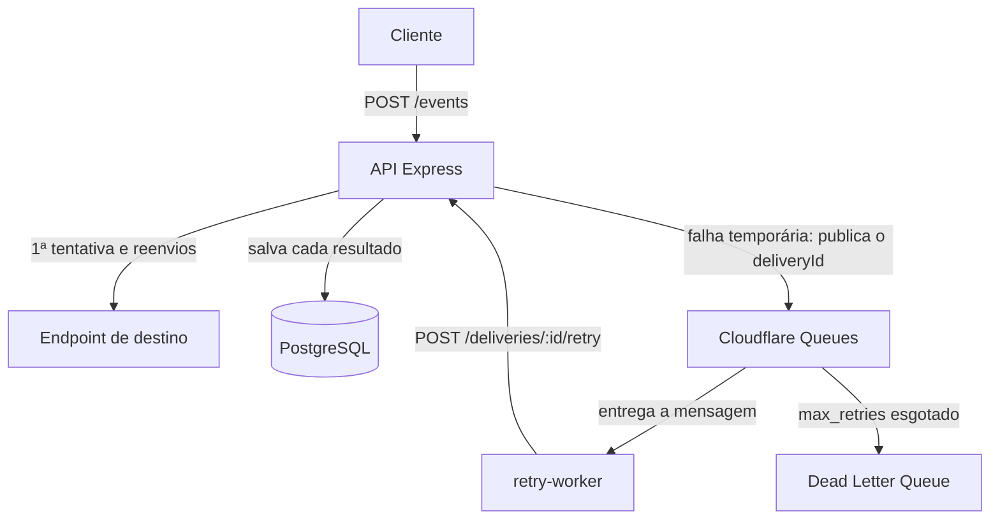

# EventRelay

API para entrega de webhooks com novas tentativas automáticas. Ela recebe um evento, envia o webhook ao endpoint cadastrado, registra o resultado no PostgreSQL e, em caso de falha temporária, agenda novas tentativas com Cloudflare Queues.

Este é um projeto de estudo e portfólio, não um sistema pronto para produção. As limitações estão descritas em [Limitações conhecidas](#limitações-conhecidas).

## O problema

Quando um sistema envia um webhook, o destino pode estar fora do ar, lento ou com erro. Sem um mecanismo de novas tentativas, o evento se perde. E tentar de novo em qualquer falha também não resolve, porque um destino que respondeu `404` não vai passar a aceitar o evento na tentativa seguinte.

O EventRelay separa esses casos: guarda o histórico de cada entrega, tenta de novo apenas quando a falha pode ser passageira e informa ao cliente o que aconteceu.

## Tecnologias

- **API:** Node.js 22 (ES Modules) e Express 5
- **Banco de dados:** PostgreSQL, com a biblioteca `pg`
- **Fila e consumidor:** Cloudflare Queues e Cloudflare Workers
- **Exposição da API local ao Worker:** Cloudflare Tunnel
- **Testes:** `node:test` na API e Vitest com `@cloudflare/vitest-plugin` no Worker

## Arquitetura



1. O cliente envia um evento para `POST /events`.
2. A API envia o webhook ao endpoint cadastrado e salva o resultado na tabela `deliveries`.
3. Se a falha for temporária, a API publica o `deliveryId` na fila.
4. O Worker consome a mensagem e chama `POST /deliveries/:id/retry` na API.
5. A API reenvia o webhook e atualiza a entrega. Com base na resposta, o Worker encerra a mensagem ou agenda outra tentativa.

### Estrutura de pastas

```text
event-relay/
├── db/schema.sql          # Criação das tabelas
├── docs/                  # Detalhes sobre SSRF e deploy
├── retry-worker/          # Cloudflare Worker que consome a fila
│   ├── src/index.js
│   ├── test/
│   └── wrangler.jsonc     # Configuração da fila e da DLQ
├── src/
│   ├── app.js             # Inicialização da API
│   ├── config/            # Conexão com o PostgreSQL
│   ├── routes/            # Definição das rotas
│   ├── controllers/       # Entrada e saída HTTP
│   ├── services/          # Regras de negócio, envio do webhook e publicação na fila
│   ├── repository/        # Consultas SQL
│   ├── middlewares/       # Autenticação e tratamento de erros
│   └── utils/             # Validações e regras compartilhadas
├── test/                  # Testes da API
└── test-server/           # Destino local para testar webhooks
```

## Como executar

**Pré-requisitos:** Node.js 22 ou superior e PostgreSQL. A conta da Cloudflare só é necessária para o retry automático.

### 1. Instalar e configurar

```bash
git clone https://github.com/gondaline/event-relay.git
cd event-relay
npm install
cp .env.example .env
```

Edite o `.env` com os seus valores. Para testar localmente com o `test-server`, use `ALLOW_PRIVATE_URLS=true`.

### 2. Criar o banco de dados

```bash
createdb -U postgres event_relay
psql -U postgres -d event_relay -f db/schema.sql
```

### 3. Iniciar a API e o destino de teste

Em terminais separados:

```bash
npm run dev               # API em http://localhost:3000
npm run dev:test-server   # Destino em http://localhost:4000/webhook
```

Sem a Cloudflare configurada, a API funciona normalmente, mas não consegue agendar novas tentativas. Nesse caso, uma falha temporária responde `502` com `retryScheduled: false`.

### Variáveis de ambiente

**API (`.env`)**

| Variável | Descrição |
|---|---|
| `DB_HOST`, `DB_PORT`, `DB_USER`, `DB_PASSWORD`, `DB_NAME` | Conexão com o PostgreSQL |
| `CLOUDFLARE_ACCOUNT_ID` | ID da conta da Cloudflare |
| `CLOUDFLARE_QUEUE_ID` | ID da fila `event-relay-retries` |
| `CLOUDFLARE_API_TOKEN` | Token da Cloudflare com a permissão `Queues Edit` |
| `WORKER_AUTH_TOKEN` | Token exigido em todas as rotas da API |
| `ALLOW_PRIVATE_URLS` | Com `true`, libera URLs locais e privadas. Use somente em desenvolvimento |
| `NODE_ENV` | Com `production`, `ALLOW_PRIVATE_URLS` é ignorada |

Para gerar um token:

```bash
node -e "console.log(require('crypto').randomBytes(32).toString('hex'))"
```

**Worker (`retry-worker/.dev.vars` em ambiente local, secrets na Cloudflare)**

| Variável | Descrição |
|---|---|
| `EVENT_RELAY_API_URL` | URL pública da API, sem barra no final |
| `WORKER_AUTH_TOKEN` | O mesmo token configurado na API |

## API

Todas as rotas exigem autenticação. Sem um token válido, a resposta é `401`:

```text
Authorization: Bearer <WORKER_AUTH_TOKEN>
```

Nas respostas, `httpStatus` é o código devolvido pelo **destino do webhook**, não o código da própria API. O valor `null` indica que não houve resposta do destino.

### `POST /endpoints`

Cadastra um destino de webhooks.

```bash
curl -X POST http://localhost:3000/endpoints \
  -H "Authorization: Bearer <WORKER_AUTH_TOKEN>" \
  -H "Content-Type: application/json" \
  -d '{"name": "Loja", "url": "http://localhost:4000/webhook"}'
```

**201 Created**

```json
{
    "endpointId": 1,
    "name": "Loja",
    "url": "http://localhost:4000/webhook"
}
```

| Código | Quando |
|---|---|
| `400` | Campos inválidos, ou URL que não pode ser usada: protocolo diferente de HTTP e HTTPS, usuário e senha na URL, endereço local, privado ou reservado, ou DNS sem resposta |
| `409` | A URL já está cadastrada |

### `POST /events`

Envia um evento ao endpoint informado e registra a entrega.

```bash
curl -X POST http://localhost:3000/events \
  -H "Authorization: Bearer <WORKER_AUTH_TOKEN>" \
  -H "Content-Type: application/json" \
  -d '{"endpointId": 1, "type": "payment.approved", "data": {"orderId": 123, "amount": 150}}'
```

O destino recebe um `POST` com os campos abaixo. Qualquer outro campo enviado pelo cliente é ignorado:

```json
{
    "endpointId": 1,
    "type": "payment.approved",
    "data": { "orderId": 123, "amount": 150 }
}
```

| Código | Quando | `retryScheduled` |
|---|---|---|
| `200` | O destino recebeu o evento | `false` |
| `202` | Falha temporária, com nova tentativa agendada | `true` |
| `422` | A URL aponta para um endereço não permitido, e o evento não foi enviado | `false` |
| `502` | O destino recusou o evento, ou a publicação na fila falhou | `false` |
| `400` | Corpo da requisição inválido | Sem o campo |
| `404` | O endpoint não existe | Sem o campo |

**200 OK**

```json
{
    "deliveryId": 1,
    "status": "SUCCESS",
    "httpStatus": 200,
    "retryScheduled": false,
    "message": "Evento entregue com sucesso"
}
```

**202 Accepted**

```json
{
    "deliveryId": 2,
    "status": "FAILED",
    "httpStatus": 500,
    "retryScheduled": true,
    "message": "A entrega falhou, e uma nova tentativa automática foi agendada"
}
```

**422 Unprocessable Content**

```json
{
    "deliveryId": 7,
    "status": "FAILED",
    "httpStatus": null,
    "retryScheduled": false,
    "message": "A URL do endpoint aponta para um endereço não permitido, e o evento não foi enviado"
}
```

**502 Bad Gateway**, quando o destino recusa o evento:

```json
{
    "deliveryId": 3,
    "status": "FAILED",
    "httpStatus": 404,
    "retryScheduled": false,
    "message": "O destino não aceitou o evento, e esse resultado não permite nova tentativa"
}
```

**502 Bad Gateway**, quando a publicação na fila falha. A entrega continua salva e pode ser recuperada manualmente, dentro do limite de tentativas:

```json
{
    "deliveryId": 6,
    "status": "FAILED",
    "httpStatus": 500,
    "retryScheduled": false,
    "message": "Evento registrado, mas a nova tentativa automática não foi agendada. Use POST /deliveries/6/retry para tentar novamente"
}
```

### `GET /deliveries/:id`

Consulta uma entrega. No banco, o status é sempre `SUCCESS` ou `FAILED`.

```bash
curl http://localhost:3000/deliveries/1 \
  -H "Authorization: Bearer <WORKER_AUTH_TOKEN>"
```

**200 OK**

```json
{
    "deliveryId": 1,
    "endpointId": 1,
    "type": "payment.approved",
    "data": { "amount": 150, "orderId": 123 },
    "status": "SUCCESS",
    "httpStatus": 200,
    "attempts": 1,
    "createdAt": "2026-11-06T15:18:51.273Z"
}
```

O PostgreSQL guarda `data` como `JSONB`, que não preserva a ordem das chaves. Os campos e os valores não mudam.

### `POST /deliveries/:id/retry`

Reenvia uma entrega. É a rota chamada pelo Worker, e também pode ser usada para a recuperação manual. As regras são as mesmas nos dois casos: a rota não ultrapassa o limite de 8 tentativas nem reenvia depois de um erro definitivo.

```bash
curl -X POST http://localhost:3000/deliveries/2/retry \
  -H "Authorization: Bearer <WORKER_AUTH_TOKEN>"
```

| Código | `status` | Significado |
|---|---|---|
| `200` | `SUCCESS` | O reenvio foi entregue |
| `502` | `FAILED` | Falha temporária. Ainda é possível tentar de novo |
| `200` | `PERMANENT_FAILURE` | Erro definitivo do destino ou URL bloqueada. No banco, a entrega continua `FAILED` |
| `200` | `ALREADY_DELIVERED` | A entrega já foi concluída, e nada é reenviado |
| `200` | `MAX_RETRIES_REACHED` | O limite de tentativas foi atingido, e nada é reenviado |
| `400` | Sem o campo | ID inválido |
| `404` | Sem o campo | A entrega não existe |

**502 Bad Gateway**

```json
{
    "deliveryId": 2,
    "status": "FAILED",
    "httpStatus": 503,
    "message": "A entrega falhou e pode ser tentada novamente"
}
```

**200 OK**

```json
{
    "deliveryId": 2,
    "status": "SUCCESS",
    "httpStatus": 200,
    "message": "Evento entregue com sucesso"
}
```

### Formato dos erros

Erros de validação, autenticação, rota inexistente e erros internos trazem apenas `message`:

```json
{
    "message": "Entrega não encontrada"
}
```

## Retry automático e Dead Letter Queue

### Quando há nova tentativa

| Resultado do envio | Nova tentativa? |
|---|---|
| `408`, `429` ou `5xx` | Sim |
| Destino sem resposta ou timeout | Sim |
| DNS sem resposta na verificação da URL | Sim |
| Outros códigos, como `3xx`, `400`, `401`, `403` e `404` | Não |
| URL que aponta para um endereço bloqueado | Não |

### Limite e intervalos

- Cada entrega tem no máximo **8 tentativas**, contando a primeira. O limite fica na API.
- O Worker usa um intervalo progressivo: 60 s, 120 s, 240 s, e assim por diante, até o máximo de 1 hora.
- Com o destino sempre falhando, as 8 tentativas levam cerca de 1 hora.

### Duas contagens diferentes

- **`attempts`, no PostgreSQL:** tentativas de entrega registradas pela API. Inclui reenvios que a verificação da URL impediu de sair.
- **`message.attempts`, na fila:** quantas vezes a Cloudflare entregou a mensagem ao Worker. Essa contagem cresce mesmo se a API estiver fora do ar.

### Como o Worker decide

A rota de retry envia o cabeçalho `X-EventRelay-Retry-Handled: true` em todas as respostas. Assim, o Worker sabe que a resposta veio da API, e não de um túnel ou servidor intermediário.

Por um túnel da Cloudflare, o `502` chega sem o cabeçalho, porque a Cloudflare o troca pela própria página de erro. O Worker agenda outra tentativa do mesmo jeito.

| Resposta recebida | Decisão |
|---|---|
| `2xx`, `400` ou `404` com o cabeçalho | Encerra a mensagem (`ack`) |
| `5xx` com o cabeçalho | Agenda outra tentativa |
| Qualquer resposta sem o cabeçalho, inclusive `200` | Agenda outra tentativa |
| Falha de rede | Agenda outra tentativa |
| Mensagem sem um `deliveryId` válido | Descarta sem chamar a API |

### Dead Letter Queue

A mensagem vai para a DLQ `event-relay-dlq` quando o Worker esgota `max_retries` (10) sem conseguir uma resposta conclusiva da API. Isso acontece, por exemplo, se a API ou o túnel ficarem fora do ar por cerca de 5 horas.

- Um webhook que esgota as 8 tentativas **não** vai para a DLQ. A API informa o limite, a mensagem é encerrada, e a entrega fica como `FAILED`.
- A DLQ não tem consumidor, então as mensagens são apagadas ao fim do período de retenção da Cloudflare: 24 horas no plano gratuito e, no plano pago, 4 dias por padrão, configurável até 14 dias.
- A entrega continua no PostgreSQL e pode ser recuperada com `POST /deliveries/:id/retry` enquanto as regras de retry permitirem: menos de 8 tentativas e nenhum erro definitivo registrado.

## Configuração da Cloudflare

Os comandos abaixo são executados dentro de `retry-worker`:

```bash
cd retry-worker
npm install
npx wrangler login
```

**1. Criar as filas**

```bash
npx wrangler queues create event-relay-retries
npx wrangler queues create event-relay-dlq
```

O ID da fila, usado em `CLOUDFLARE_QUEUE_ID`, aparece com `npx wrangler queues info event-relay-retries`. As configurações do consumidor estão em [`retry-worker/wrangler.jsonc`](retry-worker/wrangler.jsonc).

**2. Criar o token da API**

No painel da Cloudflare, crie um token com a permissão `Queues Edit` e preencha `CLOUDFLARE_API_TOKEN` e `CLOUDFLARE_ACCOUNT_ID` no `.env`.

**3. Expor a API local**

```bash
cloudflared tunnel --url http://localhost:3000
```

Em um túnel rápido como esse, a URL muda quando o `cloudflared` é reiniciado. Nesse caso, é preciso atualizar `EVENT_RELAY_API_URL`.

**4. Configurar e publicar o Worker**

```bash
npx wrangler secret put EVENT_RELAY_API_URL
npx wrangler secret put WORKER_AUTH_TOKEN
npx wrangler deploy
```

No deploy, **a API deve ser atualizada antes do Worker**. A ordem e o motivo estão em [`docs/deploy.md`](docs/deploy.md).

## Testes

```bash
# API
npm test

# Worker
cd retry-worker
npm install
npx vitest run
```

Os testes não usam PostgreSQL, rede nem conta da Cloudflare: o banco e as chamadas externas são simulados.

- **API (341 testes):** rotas, formato das respostas, regras de retry, validação de IDs, proteção contra SSRF e falhas ao publicar na fila.
- **Worker (39 testes):** rodam no `workerd`, o ambiente de execução dos Workers, e cobrem sucesso, falha temporária, erro definitivo, resposta de servidor desconhecido, falha de rede, mensagens malformadas e intervalos entre tentativas.

Além dos testes automáticos, o fluxo também foi verificado fora deles:

- **Cloudflare real:** com o Worker publicado e a fila real, uma entrega falhou três vezes e teve sucesso na quarta tentativa, com esperas crescentes entre os envios. Outra recebeu `404` e parou sem novos envios.
- **DLQ:** testada com a fila local do `wrangler dev` e menos tentativas, porque na configuração real a mensagem levaria cerca de 5 horas para chegar lá.

## Limitações conhecidas

- **Não é um sistema de produção:** a API foi pensada para rodar localmente, exposta ao Worker por um túnel.
- **PostgreSQL e fila não são atômicos:** se a publicação falhar depois de a entrega ser salva, o retry automático não acontece. O cliente é avisado e pode usar a rota de retry, dentro do limite de tentativas.
- **Webhook enviado antes de salvar:** se o banco falhar logo depois do envio, o destino recebe o evento, mas a entrega não fica registrada, e a API responde `500`.
- **Entrega "ao menos uma vez":** o destino pode receber o mesmo evento mais de uma vez, por exemplo depois de um timeout ou de uma mensagem repetida pela fila. O webhook não leva um ID para o destino detectar duplicatas.
- **Retries simultâneos:** duas chamadas ao mesmo tempo para a mesma entrega podem ultrapassar o limite de tentativas e sobrescrever o status.
- **Primeira tentativa síncrona:** o cliente espera o envio. No pior caso, são cerca de 13 s: verificação de DNS (3 s), envio (5 s) e publicação na fila (5 s).
- **Autenticação simples:** há um único token, compartilhado entre clientes e Worker, sem separação entre usuários e sem limite de requisições.
- **Webhooks sem assinatura:** o destino não tem como confirmar quem enviou o evento.
- **SSRF:** a proteção não elimina ataques de DNS rebinding. Detalhes em [`docs/ssrf.md`](docs/ssrf.md).
- **Rotas limitadas:** não há rotas para listar, editar ou remover endpoints, nem para listar entregas.
- **Cadastro duplicado:** `endpoints.url` não tem restrição `UNIQUE`, então cadastros simultâneos da mesma URL podem gerar duplicatas.

## Melhorias futuras

- Usar Transactional Outbox para publicar na fila de forma confiável.
- Enviar um ID de entrega e uma assinatura HMAC em cada webhook.
- Tornar a contagem e o limite de tentativas atômicos no banco.
- Salvar a entrega antes do primeiro envio.
- Usar tokens separados para clientes e Worker, com limite de requisições.
- Criar um consumidor para reprocessar as mensagens da DLQ.
